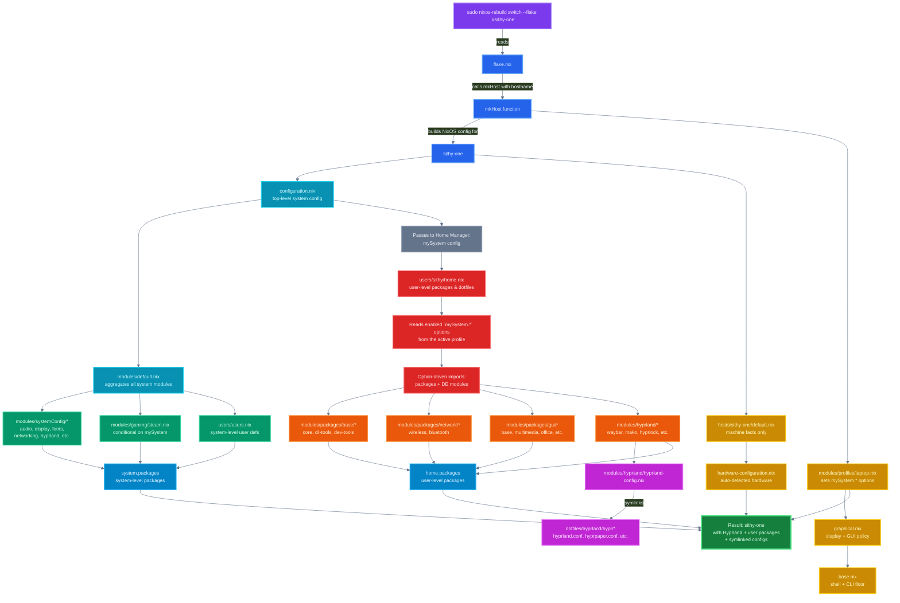

# NixOS Multi-Host Configuration

A modular, reproducible NixOS setup for **multiple hosts** using Flakes + Home Manager.

| Host | Role | Profile | Desktop | GPU |
|---|---|---|---|---|
| `sithy-top` | Desktop | `desktop.nix` | Plasma 6 | AMD (RDNA3) |
| `sithy-one` | Laptop | `laptop.nix` | Hyprland | integrated |
| *future* | Server | `server.nix` | none | any (`hardware.gpu`) |

**For newcomers to NixOS/Flakes**: this repo is written to be read. It teaches how
hosts are built from modules, how custom options control behaviour conditionally,
how Home Manager keeps user packages separate, and why the result is reproducible.

---

## Mental model in one page

If you remember nothing else, remember these five sentences.

1. **`flake.nix` lists the machines.** Each line is one host, and it names the role:
   ```nix
   sithy-top = mkHost { hostname = "sithy-top"; profile = "desktop"; };
   ```
2. **The profile is the role.** `modules/profiles/<profile>.nix` sets `mySystem.*`
   booleans. Profiles chain: `base → graphical → desktop|laptop`, and `server → base`.
3. **Modules read those booleans.** Every system module is wrapped in
   `config = lib.mkIf <option> { ... }`, so it contributes nothing when the option is off.
4. **`users/sithy/home.nix` maps booleans to package modules.** One `lib.optionals`
   line per `mySystem.packages.*` category.
5. **A host file holds only machine facts.** Hardware config, hostname, GPU vendor,
   and per-host overrides. Never shared policy.

Everything else in this README is detail hanging off those five points.

### Where do I look for…?

| I want to change… | Edit |
|---|---|
| which packages a *role* gets | `modules/profiles/*.nix` |
| what a *single machine* gets | `hosts/<name>/default.nix` |
| a system service (audio, network, drivers) | `modules/systemConfig/*.nix` |
| a user package list | `modules/packages/<category>/*.nix` |
| the set of hosts that exist | `flake.nix` → `nixosConfigurations` |
| which options exist at all | `modules/systemConfig/host-options.nix` |
| shell aliases, dotfile symlinks | `users/sithy/home.nix` |
| a Hyprland config file | `dotfiles/hyprland/…` then rebuild |

---

## Quick Start

1. Fresh NixOS install (keep the generated `hardware-configuration.nix`).
2. Clone and apply:
   ```bash
   git clone https://github.com/sithypenguin/nix-config ~/Development/nix-dev/nix-config
   cd ~/Development/nix-dev/nix-config
   sudo nixos-rebuild switch --flake .#sithy-one    # or sithy-top
   ```
3. Reboot and choose your DE at login.

### Rebuild aliases

`users/sithy/home.nix` defines three aliases, usable from any directory:

```zsh
nix-flake-dry      # nixos-rebuild dry-build  — evaluation only, no sudo
nix-flake-test     # sudo nixos-rebuild test — activates, no boot entry
nix-flake-switch   # sudo nixos-rebuild switch — activates and adds a generation
```

They expand to an absolute flake path and `#$HOST`. `$HOST` is zsh's hostname
variable; `$HOSTNAME` is a bash-ism and is empty in zsh, which would silently
degrade the reference to a bare `.#`.

---

## The design goal

One repo, many machines, deterministic output. Three properties matter:

1. **Host identity is explicit.** `nixosConfigurations.<name>` is the build target.
   `.#sithy-top` and `.#sithy-one` are separate, complete systems from one tree.
2. **Shared policy is written once.** Two desktops that both want Firefox do not each
   list Firefox. They import the same layer.
3. **A new host is a small file, not a copy-paste.** Adding a server means writing
   deltas and one line in `flake.nix` — never duplicating 20 package lines.

Everything below serves those three properties.

---

## Architecture & Design

### Key Principles

1. **Layered profiles.** Profiles form a chain, not a flat set:
   ```
   base.nix  →  graphical.nix  →  desktop.nix
                                →  laptop.nix
   server.nix  →  base.nix only
   ```
   Each layer imports the one below it and adds only what it needs. A host imports
   exactly one leaf profile.

2. **Policy-driven configuration.** A profile never installs a package. It sets
   `mySystem.*` booleans. Modules read those booleans and decide whether to
   contribute config.

3. **Home Manager first.** User packages live in Home Manager. System packages are
   reserved for drivers, services, and things root needs.

4. **Category-based packages.** Packages are grouped by purpose (`base`, `network`,
   `gui`, `gaming`, `development`) and imported when the matching
   `mySystem.packages.*` option is on.

5. **Declarative dotfiles.** Hyprland configs in `dotfiles/hyprland/` are symlinked by
   Home Manager, so they are version-controlled and reproducible.

### Why layers instead of one shared file

An earlier revision had a single `common.nix` imported by both graphical profiles.
That worked for two desktops but had no answer for a headless host: a server wants
`git`, `ripgrep`, and `zsh`, but not a cursor theme or Steam. Splitting into
`base.nix` (no display required) and `graphical.nix` (display required) means the
server imports the floor and stops, while desktops continue up the chain.

The proof that this works is in the verification section: a synthetic server host
evaluates with 48 packages, zero GUI applications, and no display manager.

### Execution Flow (Mermaid Diagram)



**Colour coding for clarity:**
- **Purple** — entry command
- **Blue** — flake infrastructure
- **Cyan** — system configuration core
- **Green** — system modules & services
- **Yellow** — host-specific files and the profile chain
- **Gray** — bridge to Home Manager
- **Red** — Home Manager configuration logic
- **Orange** — user package modules
- **Magenta** — dotfile symlinks
- **Sky Blue** — merged outputs
- **Bright Green** — final result

Each colour is a functional area, so you can trace command → flake → system config →
host config → Home Manager → packages → result.

### Configuration Flow (Text View)

```
sudo nixos-rebuild switch --flake .#sithy-one
         ↓
    flake.nix
    ├─ mkHost { hostname = "sithy-one"; profile = "laptop"; }
    │  ├─ configuration.nix
    │  │  ├─ modules/default.nix
    │  │  │  ├─ modules/systemConfig/*  (system services, audio, display, fonts)
    │  │  │  ├─ modules/gaming/*        (conditional)
    │  │  │  ├─ modules/services/*      (podman)
    │  │  │  └─ users/users.nix
    │  │
    │  ├─ hosts/sithy-one/default.nix
    │  │  ├─ hardware-configuration.nix     (auto-generated)
    │  │  └─ modules/profiles/laptop.nix    (sets mySystem options)
    │  │       └─ graphical.nix → base.nix
    │  │
    │  └─ Home Manager Integration
    │     └─ users/sithy/home.nix
    │        ├─ Option-driven package selection via mySystem.packages.*
    │        ├─ modules/packages/base/*
    │        ├─ modules/packages/network/*
    │        ├─ modules/packages/gui/*
    │        ├─ modules/packages/gaming/*
    │        ├─ modules/hyprland/* (sithy-one only)
    │        └─ modules/hyprland/hyprland-config.nix (symlinks dotfiles)
    │
    └─ Result: fully configured, reproducible system
```

### The profile chain in detail

| Profile | Imports | Adds | Used by |
|---|---|---|---|
| `base.nix` | — | zsh, base/CLI/dev packages, network base | every host |
| `graphical.nix` | `base.nix` | cursor, NetworkManager, gaming, godot, nix-ld, GUI/network packages | any host with a display |
| `desktop.nix` | `graphical.nix` | `desktop.enable`, Plasma 6, Tailscale, printing, NoMachine, Podman Desktop | `sithy-top` |
| `laptop.nix` | `graphical.nix` | `laptop.enable`, Bluetooth, Hyprland, NoMachine off | `sithy-one` |
| `server.nix` | `base.nix` | `environment = null`, SSH, NetworkManager, Podman rootless | any headless host |

GPU vendor is not part of any profile. It is `mySystem.hardware.gpu`, set per host, so
two desktops with different cards share `desktop.nix` and a headless compute box can
carry a discrete card without importing a graphical layer.

Reading a leaf profile tells you everything that host differs by. Reading the chain
tells you everything it inherits. There is no third place to look.

### Home Manager vs. System-Level Split

#### System-Level (`modules/systemConfig/`, `modules/gaming/`, `modules/services/`)
- **Services & daemons**: PipeWire, NetworkManager, Bluetooth, KDE Connect, Hyprland, Podman
- **Display**: Plasma 6 / SDDM, Hyprland, X11 keyboard layout
- **Drivers & firmware**: AMDGPU, NVIDIA, kernel modules
- **Fonts**: system-wide font packages plus fontconfig aliases
- **Core tools**: what the system or root needs

#### Home Manager (`modules/packages/`)
- **User packages**: every user-facing application and dev tool
- **GUI applications**: Firefox, VSCode, Discord, VLC, etc.
- **Utilities**: CLI tools, TUI apps, terminals
- **Gaming**: user-level Steam layered on system Steam support
- **Dotfiles**: Hyprland config symlinks via `home.file`

This split means:
- Minimal system state (easier to debug and audit)
- Clear separation between services and user-facing packages
- One rebuild path (`nixos-rebuild`), because Home Manager is a NixOS module here
- Each user can have a different package set

### Policy-Driven Package Selection

Profiles enable categories; [users/sithy/home.nix](users/sithy/home.nix) maps those
options to modules. The mapping is explicit and mechanical:

```nix
packageModules =
  (lib.optionals mySystem.packages.base.core [ profiles.base.core ])
  ++ (lib.optionals mySystem.packages.base.cliTools [ profiles.base.cliTools ])
  ++ (lib.optionals mySystem.packages.gui.office [ profiles.gui.office ])
  # ... one line per category
  ;
```

Three places, always: declare the option, map it in `home.nix`, enable it in a
profile. That repetition is deliberate — it keeps "what is available" separate from
"what this host wants", and it means a typo in a profile is a missing package rather
than a silently wrong config.

### Package Categories

**modules/packages/base/**
- [core.nix](modules/packages/base/core.nix) — git, bat, zellij, fastfetch, kitty, zsh, ripgrep, ghostty
- [cli-tools.nix](modules/packages/base/cli-tools.nix) — ncdu, btop, bmon, duf, s-tui, vhs, superfile, GPU tooling
- [dev-tools.nix](modules/packages/base/dev-tools.nix) — direnv, pkg-config, .NET SDK 10.0

**modules/packages/network/**
- [base.nix](modules/packages/network/base.nix) — dnsutils, nettools, tailscale
- [wireless.nix](modules/packages/network/wireless.nix) — networkmanagerapplet, iw
- [bluetooth.nix](modules/packages/network/bluetooth.nix) — bluetui

**modules/packages/gui/**
- [base.nix](modules/packages/gui/base.nix) — vscode, firefox, chromium, bitwarden, easyeffects, edge
- [multimedia.nix](modules/packages/gui/multimedia.nix) — vlc, spotify
- [office.nix](modules/packages/gui/office.nix) — libreoffice, obsidian, drawio
- [comms.nix](modules/packages/gui/comms.nix) — discord, telegram, element, kdeconnect
- [design.nix](modules/packages/gui/design.nix) — prusa-slicer, freecad
- [tui.nix](modules/packages/gui/tui.nix) — spotatui
- [nomachine.nix](modules/packages/gui/nomachine.nix) — pinned NoMachine client
- [podman-desktop.nix](modules/packages/gui/podman-desktop.nix) — Podman Desktop
- [hermes-desktop.nix](modules/packages/gui/hermes-desktop.nix) — Hermes Agent desktop client, from the upstream flake input

**modules/packages/gaming/**
- [steam.nix](modules/packages/gaming/steam.nix) — user-level Steam

**modules/packages/development/**
- [godot.nix](modules/packages/development/godot.nix) — Godot from unstable

---

## Key Concepts for Beginners

### What Is a Flake?

A **flake** is a standardised way to package a Nix project. `flake.nix`:
- **Declares inputs** — which nixpkgs revisions you need (like `package.json`)
- **Defines outputs** — what builds you produce (`nixosConfigurations`)
- **Locks versions** — `flake.lock` pins exact commits (like `yarn.lock`)

```
User runs: sudo nixos-rebuild switch --flake .#sithy-one
         ↓
Nix reads: flake.nix and flake.lock
         ↓
Finds output: nixosConfigurations.sithy-one
         ↓
Builds the system with those exact pinned versions
```

Anyone who clones this repo and runs the same command gets identical results, down to
package versions.

### The Module System

Everything in NixOS is a **module**: a function returning options and values.

```nix
{ config, pkgs, lib, ... }:
{
  options = { /* what can be configured */ };
  config  = { /* what the values are */ };
}
```

Importing several modules **merges** them:

```nix
# Module A (modules/systemConfig/audio.nix)
{ services.pipewire.enable = true; }

# Module B (modules/systemConfig/display.nix)
{ services.pipewire.extra_settings = { ... }; }

# After merge:
{ services.pipewire = { enable = true; extra_settings = { ... }; }; }
```

**Key insight**: `imports` does not just load files, it merges their configs. That is
how multiple files define different parts of one service without conflicting.

### Custom Options: The `mySystem.*` Pattern

Instead of scattering `if-then-else` through modules:

1. **Define** once (`modules/systemConfig/host-options.nix`):
   ```nix
   options.mySystem.laptop.enable = lib.mkEnableOption "laptop-specific system configuration";
   ```
2. **Set** per host (`modules/profiles/laptop.nix`):
   ```nix
   mySystem.laptop.enable = true;
   ```
3. **Use** conditionally in any module:
   ```nix
   config = lib.mkIf config.mySystem.laptop.enable {
     services.pipewire.enable = true;
   };
   ```

All definitions live in one file, all per-host values live in profiles, and modules
just reference them. Adding an option is one edit, not five.

### Home Manager: User Packages & Dotfiles

Home Manager is a NixOS module that builds user-level configuration. It manages:
- User packages (Firefox, VSCode, CLI tools)
- Dotfiles (symlinked from `~/.config/` into the Nix store)
- User services and programs

**How it integrates here**:
1. `flake.nix` passes `mySystem` to Home Manager via `extraSpecialArgs`
2. `users/sithy/home.nix` reads those options
3. Home Manager imports package groups and DE modules from them
4. Everything still goes through `sudo nixos-rebuild` — Home Manager is a NixOS
   module in this flake, not a separate tool

**One package set, not two.** `home-manager.useGlobalPkgs = true` in `flake.nix` makes
Home Manager reuse the system's `pkgs` instead of building its own. That is why
`allowUnfree` only needs to be declared in `modules/systemConfig/sysConfig.nix`: Home
Manager inherits it. The one exception is `pkgs-unstable` in `flake.nix`, which is a
separate instance and sets its own.

**Difference from stand-alone Home Manager**: normally you run `home-manager switch`
separately. Here one command rebuilds both.

### Why `lib.mkIf`, `lib.mkOption`, and Friends?

The `lib.mk*` functions are merge-aware primitives:
- `lib.mkOption` — declares that an option exists
- `lib.mkIf cond { ... }` — include config only when `cond` is true
- `lib.mkDefault value` — a default other modules can override
- `lib.mkAfter` / `lib.mkBefore` — control list merge order

They exist because merging is more than concatenation. Without them NixOS would not
know what to do when two modules set the same option, whether a value is included, or
in what order list items appear.

### Fonts: how they are wired

Fonts are system-wide in [modules/systemConfig/fonts.nix](modules/systemConfig/fonts.nix),
which does two separate things:

1. **Installs** the packages (`fira-code`, `fira-sans`, `nerd-fonts.fira-code`,
   `font-awesome`, `jetbrains-mono`) into the system font path, visible to every user
   through fontconfig.
2. **Sets the aliases** so the generic families actually resolve to them:
   ```nix
   fontconfig.defaultFonts = {
     monospace = [ "FiraCode Nerd Font Mono" "JetBrains Mono" ];
     sansSerif = [ "Fira Sans" ];
     serif     = [ "Fira Sans" ];
     emoji     = [ "Noto Color Emoji" ];
   };
   ```

Step 2 is the part that makes the config *take*. Without it, fontconfig resolves
`monospace` to whatever nixpkgs lists first — Hack, on this system — so a terminal
asking for "monospace" would not get Fira Code. With it, the alias wins and the
declared fonts are used.

Applications that name a family explicitly (`kitty`, `waybar`, `rofi`, `mako` all ask
for `FiraCode Nerd Font Mono`) resolve through the same fontconfig database, so they
pick these up with no per-app change.

Verify after a rebuild:

```bash
fc-match monospace     # → FiraCodeNerdFontMono-Regular.ttf
fc-match sans-serif    # → FiraSans-Regular.ttf
fc-list | grep -ci fira
```

---

## Making Changes to Your Configuration

All changes flow through `nixos-rebuild`:

```bash
nano modules/systemConfig/audio.nix          # system service
nano modules/packages/gui/base.nix           # user package
nano dotfiles/hyprland/hypr/hyprland.conf    # dotfile

sudo nixos-rebuild switch --flake .#sithy-one
```

Whether you edit system config, user packages, or dotfiles, the command is the same.

### Editing Dotfiles Safely

Files in `~/.config/` are read-only symlinks into the Nix store. Editing them
directly will not persist.

```bash
# ❌ Wrong: edits are lost
nano ~/.config/hypr/hyprland.conf

# ✅ Correct: edit the source, then rebuild
nano dotfiles/hyprland/hypr/hyprland.conf
sudo nixos-rebuild switch --flake .#sithy-one
```

---

## Detailed Task Examples

### Task 1: Add a User Package (to One or All Hosts)

**Problem**: you want a GUI app or CLI tool for your user. Example: `htop`.

**Solution**:

1. **Pick the right module** in `modules/packages/`:
   - `base/core.nix` — essential CLI (git, kitty, zsh, bat)
   - `base/cli-tools.nix` — utilities (ncdu, btop, …)
   - `base/dev-tools.nix` — development (direnv, pkg-config)
   - `gui/base.nix` — core GUI apps (Firefox, VSCode)
   - `gui/multimedia.nix` — VLC, Spotify
   - `gui/office.nix` — LibreOffice, Obsidian
   - `gui/comms.nix` — Discord, Telegram
   - `gui/design.nix` — Prusa Slicer
   - `network/*` — network tools

2. **Add the package**:

   **Before** (`modules/packages/base/cli-tools.nix`):
   ```nix
   home.packages = with pkgs; [
     ncdu
     btop
     bmon
     duf
   ];
   ```

   **After**:
   ```nix
   home.packages = with pkgs; [
     ncdu
     btop
     bmon
     duf
     htop  # ← added
   ];
   ```

3. **Verify it exists**:
   ```bash
   nix search nixpkgs htop
   ```

4. **Rebuild**:
   ```bash
   sudo nixos-rebuild switch --flake .#sithy-one
   ```

5. **Verify**:
   ```bash
   which htop
   ```

**What can break**:
- Package not in nixpkgs — search first
- Forgot to rebuild — nothing appears until you do
- Package is unstable-only — use `pkgs-unstable.package-name` (modules receive it)
- Category not enabled in the profile — check the matching `mySystem.packages.*`

**For one host only**: enable the category in that profile alone.

---

### Task 2: Add a System Package or Service (e.g., Enable Bluetooth)

**Problem**: enable a system-level service all users need.

**Solution**:

1. **Check whether the module already exists**:
   ```bash
   ls modules/systemConfig/
   ```

2. **If it exists**, confirm it is conditional:
   ```nix
   # modules/systemConfig/bluetooth.nix
   { config, pkgs, lib, ... }:
   {
     config = lib.mkIf config.mySystem.hardware.bluetooth {
       hardware.bluetooth.enable = true;
       hardware.bluetooth.powerOnBoot = true;
     };
   }
   ```

3. **Enable it in the profile** (`modules/profiles/laptop.nix`):
   ```nix
   mySystem.hardware.bluetooth = true;
   ```

4. **Rebuild and verify**:
   ```bash
   sudo nixos-rebuild switch --flake .#sithy-one
   systemctl status bluetooth
   ```

**If the module does not exist**, create it:

1. **Write** `modules/systemConfig/my-service.nix`:
   ```nix
   { config, pkgs, lib, ... }:
   {
     config = lib.mkIf config.mySystem.myNewOption {
       services.my-service.enable = true;
     };
   }
   ```
2. **Declare the option** in `host-options.nix`:
   ```nix
   myNewOption = mkEnableOption "my service";
   ```
3. **Import it** in `modules/default.nix`:
   ```nix
   imports = [
     ./systemConfig/my-service.nix  # ← add here
   ];
   ```
4. **Enable it** in a profile:
   ```nix
   mySystem.myNewOption = true;
   ```
5. **Rebuild**.

**What can break**:
- Forgot the option in `host-options.nix` — modules cannot read it
- Forgot the import in `modules/default.nix` — the module never runs
- Service dependency missing
- Invalid NixOS option — check [search.nixos.org/options](https://search.nixos.org/options)

---

### Task 3: Add a New Host (e.g., a server)

**Problem**: you have another machine and want it in this flake.

**Solution**:

1. **Generate hardware config on the new machine**:
   ```bash
   nixos-generate-config --show-hardware-config > hardware-configuration.nix
   ```

2. **Create the host directory**:
   ```bash
   mkdir -p hosts/sithy-three
   cp hardware-configuration.nix hosts/sithy-three/
   ```

3. **Write** `hosts/sithy-three/default.nix` — profile comes from `flake.nix`, so this
   file holds only machine-specific facts:
   ```nix
   { ... }:
   {
     imports = [ ./hardware-configuration.nix ];

     mySystem = {
       hardware.gpu = "intel";        # "amd" | "nvidia" | "intel" | null
       services.podman.enable = true;
     };

     networking.hostName = "sithy-three";
   }
   ```

4. **Add one line to `flake.nix`** — the `profile` argument selects the role:
   ```nix
   nixosConfigurations = {
     sithy-one   = mkHost { hostname = "sithy-one"; profile = "laptop"; };
     sithy-top   = mkHost { hostname = "sithy-top"; profile = "desktop"; };
     sithy-three = mkHost { hostname = "sithy-three"; profile = "server"; };  # ← add
   };
   ```

5. **Add host-specific overrides** on top of the profile if needed. Profile values use
   `lib.mkDefault`, so a plain assignment overrides them without `lib.mkForce`:
   ```nix
   mySystem.services.ollama.enable = true;
   mySystem.packages.gui.nomachine = false;
   ```

6. **Test without building**:
   ```bash
   nix flake check --no-build
   ```

7. **On the new machine**:
   ```bash
   git clone https://github.com/sithypenguin/nix-config ~/Development/nix-dev/nix-config
   cd ~/Development/nix-dev/nix-config
   sudo nixos-rebuild switch --flake .#sithy-three
   ```

**What can break**:
- Copied hardware config from another machine — regenerate on the target
- `networking.hostName` does not match the flake attribute name
- Wrong profile for the hardware
- A `username` that has no matching `users/<name>/home.nix` — evaluation fails with
  `Path 'users/<name>/home.nix' does not exist in Git repository`

**Note**: `nix flake check` only sees git-tracked files. A brand-new host directory
must be `git add`ed before it evaluates.

**Different account per host**: `mkHost` takes `username`, which drives both the Home
Manager user and `mySystem.primaryUser`:

```nix
srv-media = mkHost { hostname = "srv-media"; profile = "server"; username = "media"; };
```

That requires `users/media/home.nix` to exist, and `users/users.nix` creates the
account from `mySystem.primaryUser`, so the two cannot disagree.

**`extraModules`**: `mkHost` also accepts a list of extra modules, for a one-off host
that needs something no profile expresses:

```nix
odd-box = mkHost {
  hostname = "odd-box";
  profile = "server";
  extraModules = [ ./hosts/odd-box/extra.nix ];
};
```

Prefer a profile change when more than one host needs it.

---

### Task 4: Remove or Disable a Package

**Problem**: you installed something you no longer want. Example: `spotify`.

**Solution**:

1. **Comment it out** in `modules/packages/gui/multimedia.nix`:
   ```nix
   home.packages = with pkgs; [
     vlc
     # spotify  # ← disabled
   ];
   ```

2. **Rebuild**:
   ```bash
   sudo nixos-rebuild switch --flake .#sithy-one
   ```

3. **Verify**:
   ```bash
   which spotify
   ```

4. **Optionally collect garbage**:
   ```bash
   nix-collect-garbage -d
   sudo nix-collect-garbage -d
   ```

**Why comment instead of delete?** Easier to re-enable, clearer git history, and no
risk of breaking list syntax.

---

### Task 5: Modify a Dotfile Safely (e.g., Hyprland Config)

**Problem**: change a keybind, colour, or bar layout.

**Solution**:

1. **Never edit `~/.config/`** — those are read-only symlinks.
2. **Edit the source**:
   ```bash
   nano dotfiles/hyprland/hypr/hyprland.conf
   ```
3. **Make the change**:
   ```conf
   bind = $mainMod, RETURN, exec, $terminal
   bind = $mainMod, Q, killactive,
   bind = $mainMod, F11, togglefloating,   # ← added
   ```
4. **Rebuild**:
   ```bash
   sudo nixos-rebuild switch --flake .#sithy-one
   ```
5. **Reload Hyprland** without reboot:
   ```bash
   hyprctl reload
   ```
6. **Verify**:
   ```bash
   grep togglefloating ~/.config/hypr/hyprland.conf
   ```

**Other dotfiles** follow the same pattern:
- Waybar: `dotfiles/hyprland/waybar/config.json` + `style.css`
- Mako: `dotfiles/hyprland/mako/config`
- Rofi: `dotfiles/hyprland/rofi/config.rasi`
- Kitty: `dotfiles/hyprland/kitty/kitty.conf`

**What can break**:
- Syntax error — Hyprland will not start; `hyprctl reload` reports it
- Editing the symlink — changes vanish on next rebuild
- Forgetting to rebuild — `dotfiles/` changes are inert until then

---

### Task 6: Disable a Feature Per-Host (e.g., Disable Gaming)

**Problem**: gaming is on for `sithy-top` but you want it off without deleting config.

**Solution**:

1. **Find the option**:
   ```bash
   grep "mkEnableOption\|mkOption" modules/systemConfig/host-options.nix
   ```

2. **Override it in the host file.** Profile values use `lib.mkDefault`, so a plain
   assignment in `hosts/<name>/default.nix` wins without `lib.mkForce`:
   ```nix
   # hosts/sithy-top/default.nix
   mySystem.gaming.steam = false;
   ```
   To disable it for every graphical host instead, edit `modules/profiles/graphical.nix`.

3. **Rebuild and verify**:
   ```bash
   sudo nixos-rebuild switch --flake .#sithy-top
   which steam
   ```

**What can break**:
- Option does not exist — check `host-options.nix`
- Typo in the option name — NixOS will not error, the module simply never activates
- Module imported unconditionally — disabling the option will not remove it

---

### Task 7: Switch to Unstable or Stable Packages

**Problem**: you want a newer version than stable nixpkgs provides.

**Solution**:

The flake already carries both channels:
- `nixpkgs` — stable (26.05)
- `nixpkgs-unstable` — rolling

**Option 1: one package from unstable**
```nix
{ pkgs, pkgs-unstable, ... }:
{
  home.packages = with pkgs; [
    git
    pkgs-unstable.ghostty  # ← unstable
  ];
}
```

**Option 2: whole tree from unstable** — swap the inputs in `flake.nix`, then:
```bash
nix flake update
sudo nixos-rebuild switch --flake .#sithy-one
```

**Option 3: check availability first**
```bash
nix search nixpkgs firefox
nix search github:nixos/nixpkgs/nixos-unstable firefox
```

**Revert**:
```bash
git checkout flake.lock
sudo nixos-rebuild switch --flake .#sithy-one
```

---

## Common Pitfalls & Debugging

### "Everything broke when I edited systemConfig"

1. **Check syntax without building**:
   ```bash
   nix flake check --no-build
   ```
2. **Review the change**:
   ```bash
   git diff modules/systemConfig/
   ```
3. **Common mistakes**:
   - Missing import in `modules/default.nix`
   - Option referenced but not declared in `host-options.nix`
   - Invalid NixOS option — check [search.nixos.org/options](https://search.nixos.org/options)
4. **Revert**:
   ```bash
   git checkout modules/systemConfig/audio.nix
   sudo nixos-rebuild switch --flake .#sithy-one
   ```

### "I added a package but it didn't install"

1. Is it in nixpkgs? `nix search nixpkgs <name>`
2. Is its category enabled for this host? Check the profile chain.
3. Did you rebuild?
4. Prove it landed in the evaluated config, not just the source file:
   ```bash
   nix eval --raw .#nixosConfigurations.sithy-top.config.home-manager.users.sithy.home.packages \
     --apply 'ps: builtins.concatStringsSep "\n" (map (p: p.name) ps)' | grep <name>
   ```

### "I can't edit my dotfiles; changes keep reverting"

`~/.config/` entries are read-only symlinks into the Nix store.
```bash
ls -la ~/.config/hypr/hyprland.conf
# → /nix/store/xxx-hyprland.conf
```
Edit `dotfiles/` and rebuild.

### "I cloned this on a new host and it doesn't work"

1. Hardware config generated **on that machine**?
2. Hostname present in `flake.nix`?
3. Host imports the right profile?
4. `hosts/<name>/` contains both `default.nix` and `hardware-configuration.nix`?
5. New files `git add`ed? `nix flake check` cannot see untracked files.

### "Module evaluation order is confusing me"

Modules are **not** evaluated in random order:
1. NixOS collects all modules from `imports`
2. Merges all option definitions
3. Evaluates config values against the merged options

Order rarely matters because options are idempotent. It matters when module B
*depends on values set by* module A, or for list options where `lib.mkBefore` /
`lib.mkAfter` control position.

### "I'm seeing duplicate packages or conflicting options"

1. Check for duplicate imports:
   ```bash
   grep -r "audio.nix" modules/
   ```
2. Use `lib.mkIf` so a module contributes only when its option is on.
3. Read the error — it names the conflicting modules.

### "My changes don't apply even after rebuild"

1. Did the rebuild succeed? `echo $?`
2. Did you rebuild the host you are on? `hostnamectl`
3. Is the change in the file? `grep` it.
4. For packages, is the category enabled?

### "How do I safely test changes before applying?"

```bash
nix flake check --no-build                    # evaluation only, fast
nixos-rebuild dry-build --flake .#sithy-top   # what would be built
sudo nixos-rebuild switch --flake .#sithy-top # reversible via previous generation
```

If a switch breaks the session, pick the previous generation at the bootloader.

### "Options I know are used look unused"

Several modules consume options through an alias:

```nix
let cfg = config.mySystem.services.podman;
in { config = lib.mkIf cfg.enable { ... }; }
```

A grep for the full `mySystem.` path will not find `cfg.enable`. Search for `cfg.` too
before concluding an option is dead.

---

## Verifying a Change

```bash
# Does everything still evaluate?
nix flake check --no-build

# What would be built
nixos-rebuild dry-build --flake .#sithy-top

# Prove a package is in the evaluated config
nix eval --raw .#nixosConfigurations.sithy-top.config.home-manager.users.sithy.home.packages \
  --apply 'ps: builtins.concatStringsSep "\n" (map (p: p.name) ps)' | grep <package>

# Prove an option resolved
nix eval .#nixosConfigurations.sithy-top.config.mySystem.packages.gui.office

# Prove fonts resolved
nix eval .#nixosConfigurations.sithy-top.config.fonts.fontconfig.defaultFonts --json
```

`nix flake check` warns "Git tree is dirty" with uncommitted edits. Harmless — it
reads the working tree. It does, however, only see git-tracked files, so a new module
must be `git add`ed before it evaluates.

`nix flake check` also runs the `checks` output. `server-profile-is-headless` fails the
build if any host with `environment == null` carries a GUI package:

```
GUI packages on headless hosts: srv-c: vscode-1.144.0, srv-c: firefox-159.0.1
```

---

## Garbage collection

`modules/systemConfig/sysConfig.nix` enables automatic collection on every host:

```nix
nix.gc = {
    automatic = true;
    dates = "weekly";
    options = "--delete-older-than 14d";
    persistent = true;
};
nix.settings.auto-optimise-store = true;
```

- **weekly + 14d** keeps at least one prior generation as a rollback target.
  `--delete-old` would keep only the current one and remove that safety net.
- **persistent** makes the timer catch up after downtime, which matters for a laptop
  and homelab boxes that are not always on.
- **auto-optimise-store** hard-links identical store paths so repeated builds stop
  multiplying copies.

Check what would be removed without removing it:

```bash
sudo nix-collect-garbage --dry-run --delete-older-than 14d
```

List current generations:

```bash
sudo nix-env --list-generations --profile /nix/var/nix/profiles/system
```

---

## Directory Structure

```
nix-config/
├── flake.nix                    # Entry point, mkHost, nixosConfigurations
├── flake.lock                   # Pinned package versions
├── README.md                    # This file
├── configuration.nix            # Imports modules/; system.stateVersion
│
├── assets/
│   ├── background-pictures/     # Wallpapers used by Hyprland
│   └── wlogout/                 # SVG icons for the power menu
│
├── dotfiles/
│   └── hyprland/                # Symlinked by Home Manager
│       ├── hypr/                # hyprland, hyprpaper, hyprlock, hypridle
│       ├── waybar/              # config.json, style.css
│       ├── wlogout/             # layout, style.css
│       ├── mako/config
│       ├── kitty/kitty.conf
│       └── rofi/config.rasi
│
├── hosts/
│   ├── sithy-one/               # default.nix + hardware-configuration.nix
│   └── sithy-top/               # default.nix + hardware-configuration.nix
│
├── modules/
│   ├── default.nix              # The single import list
│   │
│   ├── profiles/                # Policy chain
│   │   ├── base.nix             #   floor: shell + CLI
│   │   ├── graphical.nix        #   + display, GUI, gaming, NetworkManager
│   │   ├── desktop.nix          #   + Plasma 6, Tailscale, printing
│   │   ├── laptop.nix           #   + Hyprland, Bluetooth
│   │   └── server.nix           #   headless: base + SSH, NetworkManager, Podman
│   │
│   ├── systemConfig/
│   │   ├── host-options.nix     # Every mySystem option, declared once
│   │   ├── fonts.nix            # Font packages + fontconfig aliases
│   │   ├── audio.nix            # PipeWire (any host with a display)
│   │   ├── bluetooth.nix        # Bluetooth hardware
│   │   ├── display.nix          # X11, SDDM, Plasma 6
│   │   ├── networking.nix       # NetworkManager, KDE Connect
│   │   ├── amd.nix              # AMDGPU        (hardware.gpu = "amd")
│   │   ├── nvidia.nix           # NVIDIA        (hardware.gpu = "nvidia")
│   │   ├── intel.nix            # Intel iGPU    (hardware.gpu = "intel")
│   │   ├── hyprland.nix         # Hyprland system module
│   │   ├── nix-ld.nix           # Dynamic linker shim
│   │   ├── ollama.nix           # Ollama service
│   │   ├── openssh.nix          # OpenSSH server
│   │   ├── sysConfig.nix        # Bootloader, locale, timezone, printing, GC
│   │   ├── tailscale.nix        # Tailscale service
│   │   └── zsh.nix              # Default shell
│   │
│   ├── hyprland/
│   │   ├── hyprland.nix         # User packages (waybar, mako, hyprlock, …)
│   │   ├── hyprland-config.nix  # Dotfile symlinks
│   │   └── cachix.nix           # Hyprland binary cache
│   │
│   ├── gaming/
│   │   ├── steam.nix            # System Steam
│   │   └── gamescope.nix        # Nested compositor
│   │
│   ├── services/
│   │   └── podman.nix           # Rootless/rootful Podman
│   │
│   └── packages/                # Home Manager package categories
│       ├── base/                # core, cli-tools, dev-tools
│       ├── network/             # base, wireless, bluetooth
│       ├── gui/                 # base, multimedia, office, comms, design, tui, …
│       ├── gaming/steam.nix
│       └── development/godot.nix
│
├── users/
│   ├── users.nix                # System user definitions
│   └── sithy/home.nix           # Home Manager entry point
│
└── obsolete/                    # Superseded files, kept for reference (gitignored)
```

Note: `nix fmt` with no arguments walks the whole tree and aborts on
`obsolete/gui-packages.nix`, which is a deliberately non-parsing stub. Format the
tracked files instead:

```bash
nix fmt $(git ls-files '*.nix')
```

---

## What Makes This Reproducible

1. **`flake.lock`** pins exact nixpkgs revisions
2. **Declarative only** — no imperative setup steps
3. **Dotfiles in repo** — Hyprland configs are version-controlled
4. **One command** rebuilds system and user config together
5. **Hardware detection is the only machine-specific input**

---

## Configuration Options

All options are declared in `modules/systemConfig/host-options.nix`.

### Roles and hardware

| Option | Type | Read by |
|---|---|---|
| `mySystem.primaryUser` | str | `users/users.nix`, `services/podman.nix` default |
| `mySystem.laptop.enable` | bool | `audio.nix`, `display.nix` |
| `mySystem.desktop.enable` | bool | `tailscale.nix` |
| `mySystem.hardware.gpu` | `null` \| `"amd"` \| `"nvidia"` \| `"intel"` | `amd.nix`, `nvidia.nix`, `intel.nix`, `ollama.nix` |
| `mySystem.hardware.nvidiaOpen` | bool (default true) | `nvidia.nix` |
| `mySystem.hardware.bluetooth` | bool | `bluetooth.nix` |
| `mySystem.environment` | `null` \| `"hyprland"` \| `"plasma6"` | `display.nix`, `hyprland.nix`, `audio.nix`, `cachix.nix`, `home.nix` |
| `mySystem.cursor.*` | package / str / int | `home.nix` |

`environment` defaults to `null`, so a host that imports only `base.nix` cannot
silently acquire a display manager.

### Features

| Option | Read by |
|---|---|
| `mySystem.gaming.steam` | `gaming/steam.nix` |
| `mySystem.gaming.gamescope` | `gaming/gamescope.nix` |
| `mySystem.development.godot` | `packages/development/godot.nix` |
| `mySystem.development.nixLd` | `nix-ld.nix` |
| `mySystem.shell.zsh` | `zsh.nix` |
| `mySystem.networking.tailscale` | `tailscale.nix` |
| `mySystem.networking.networkmanager` | `networking.nix`, `users/users.nix` |
| `mySystem.services.printing` | `sysConfig.nix` |
| `mySystem.services.openssh` | `openssh.nix` |
| `mySystem.services.ollama.{enable,port}` | `ollama.nix` |
| `mySystem.services.podman.{enable,rootless,user,compose}` | `services/podman.nix` |

`services.podman.user` defaults to `mySystem.primaryUser`, so a host does not repeat
the account name.

### User packages

`packages.base.{core,cliTools,devTools}`, `packages.network.{base,wireless,bluetooth}`,
`packages.gui.{base,multimedia,office,comms,design,tui,nomachine,podmanDesktop,hermesDesktop}`,
`packages.gaming.steam`, `packages.development.godot` — mapped in
`users/sithy/home.nix`.

### Hermes Agent desktop client

`mySystem.packages.gui.hermesDesktop` installs the Electron desktop app from the
`hermes-agent` flake input. The package ships its own `.desktop` entry and icon, so
`home.packages` is enough — it appears in the launcher as **Hermes** and on `PATH` as
`hermes-desktop`.

The input is deliberately **not** `inputs.nixpkgs.follows = "nixpkgs"`:

```nix
hermes-agent = {
    url = "github:NousResearch/hermes-agent";
    inputs.nixpkgs.url = "github:NixOS/nixpkgs/02c087f3fe673c9e317f206a627cb6b910336dbe";
};
```

Following this repo's `nixos-26.05` nixpkgs breaks the build in two independent ways:
`fetch-pnpm-deps` calls `pnpm.override`, which that nixpkgs' pnpm does not expose, and
`patchelf-0.15.2`'s patch set no longer applies. The pinned revision is the one in
`hermes-agent`'s own `flake.lock`, so it is the combination upstream actually tests.

To move the app to a different host, set the option in that host's profile or
`default.nix`; to drop it, set it `false`.

### Ollama Example

[modules/systemConfig/ollama.nix](modules/systemConfig/ollama.nix):
- enables `services.ollama` when `mySystem.services.ollama.enable = true`
- forwards `mySystem.services.ollama.port`
- picks `ollama-rocm` on AMD, `ollama-cuda` on NVIDIA, `ollama` otherwise
- binds to `127.0.0.1` with the firewall closed

Enable it on one host with a single line in that host's profile or `default.nix`:

```nix
mySystem.services.ollama.enable = true;
```

---

## Learning Resources & Study Path

### For complete newcomers

1. [How Nix works](https://nixos.org/guides/how-nix-works/) (5 min)
2. [NixOS modules](https://nixos.wiki/wiki/NixOS_modules) (10 min)
3. [Flakes introduction](https://nixos.wiki/wiki/Flakes) (15 min)

### Read this repo in order

1. [flake.nix](flake.nix) — inputs, `mkHost`, outputs
2. [modules/profiles/base.nix](modules/profiles/base.nix) — the floor
3. [modules/profiles/graphical.nix](modules/profiles/graphical.nix) — what a display adds
4. [modules/profiles/desktop.nix](modules/profiles/desktop.nix) / [laptop.nix](modules/profiles/laptop.nix) / [server.nix](modules/profiles/server.nix) — deltas
5. [modules/systemConfig/host-options.nix](modules/systemConfig/host-options.nix) — every option
6. [modules/default.nix](modules/default.nix) — the import list
7. [hosts/sithy-top/default.nix](hosts/sithy-top/default.nix) — host wiring
8. [users/sithy/home.nix](users/sithy/home.nix) — options → modules

### External documentation

- [NixOS Manual](https://nixos.org/manual/nixos/stable/)
- [Home Manager Manual](https://nix-community.github.io/home-manager/)
- [Nix Pills](https://nixos.org/guides/nix-pills/)
- [Hyprland Wiki](https://wiki.hyprland.org/)
- [NixOS Search](https://search.nixos.org/)

### Debugging tips

```bash
nix flake show                                             # what outputs exist
nix eval .#nixosConfigurations.sithy-one.config.mySystem   # inspect values
nix flake check --no-build                                 # evaluation gate
```

---

## License

Provided as-is for educational and personal use.
